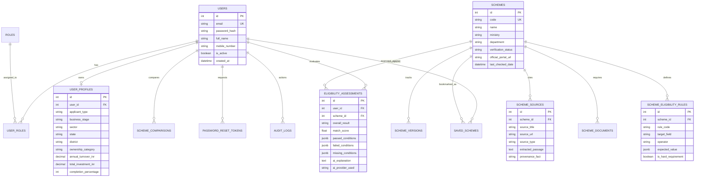

# P21: AI Scheme-Matching Advisor for Indian Entrepreneurs

**P21** is a university-grade advisory platform engineered to empower Indian entrepreneurs, micro-enterprises, and startup founders to discover, evaluate, and navigate Central Government business assistance schemes.

The platform combines a **two-tier matching engine** (strict deterministic rule evaluation followed by source-grounded LLM synthesis), **native PostgreSQL 17 persistence**, **robust security controls**, and a **custom Indian government digital design system** built in React 19 and Tailwind CSS v4.

---

### Key Capabilities

1. **Dual Authentication Portals**: Separate portals for Citizen Entrepreneurs and Government Administrators with strict backend role enforcement, rate limiting, and HTTP-only cookie sessions.
2. **Comprehensive Entrepreneur Profiles**: Captures applicant type, business stage, sector, turnover, investment, beneficiary categories, district/state, and Udyam registration status.
3. **Data Pipeline & 111 Ingested Schemes**: Automated ingestion pipeline processing the Hugging Face `shrijayan/gov_myscheme` dataset with zero-width whitespace normalization, duplicate detection, and Central vs. State classification. Currently persists 111 Central schemes, 115 cited sources, 120 rules, and 307 catalogued documents.
4. **Real AI Layer & Hybrid RAG**: Conversational discovery engine combining lexical keyword expansion, sector affinity, and verification ranking with prompt injection defenses (`<<<START_RETRIEVED_DOCUMENT>>>`). Supports Google Gemini 2.5 Flash, local Ollama, and a 100% deterministic grounded fallback engine.
5. **Multi-Factor Recommendation Engine**: Transparent, explainable scoring ($w_e \times 50\% + w_p \times 25\% + w_v \times 15\% + w_{ev} \times 10\%$) with hard disqualification caps and four human-readable match categories.
6. **Eligibility Gap Analysis & Roadmaps**: Dedicated gap analysis breakdown (`/schemes/:id/gap-analysis`) displaying missing profile fields with "why it matters" rationales, disqualification explanations, and actionable next steps.
7. **Interactive Entrepreneur Tools**: Scheme search, side-by-side comparison matrix with dynamic scheme addition, document checklist tracker with printable exports, and bookmarking.
8. **Administrator Control Center**: Data pipeline coverage audit (`/admin/coverage`), scheme verification transitions (`Candidate` $\rightarrow$ `Verified`), user management, and tamper-resistant audit logs.
9. **Dual-Mode Hosting**: Runs seamlessly in two modes on a local Windows laptop:
   - **Development Mode**: Vite dev server (`:5173`) + FastAPI backend (`:8000`).
   - **Hosted Mode**: Single-process FastAPI server serving pre-compiled React static assets on `http://localhost:8000`.

---

## Entity-Relationship (ER) Schema



---

## Quickstart Guide (PowerShell)

All commands must be executed from the project root directory in PowerShell.

### 1. Prerequisites Verification & Setup
Installs backend dependencies into a local virtual environment (`.\venv`), installs frontend Node packages, and generates `.env` with cryptographically secure random secrets.
```powershell
.\scripts\setup.ps1
```

### 2. Database Initialization & Migrations
Connects to local PostgreSQL 17, provisions the `p21_user` role and `p21` database, and applies Alembic migrations:
```powershell
.\scripts\init-db.ps1
```

### 3. Scheme Ingestion & Data Pipeline
Populates verified Central Government schemes and candidate schemes from the MyScheme Hugging Face dataset:
```powershell
.\scripts\import-schemes.ps1
```

Or run the full reproducible batch pipeline CLI:
```powershell
.\venv\Scripts\python -m backend.scripts.ingest_dataset --batch-size 150 --filter-central
```

### 4. Administrator Account Provisioning
Securely provisions a system administrator account. Supports interactive prompts or parameterized execution:
```powershell
.\scripts\create-admin.ps1 -Email "admin@p21.gov.in" -Password "AdminDemonstration2026!" -FullName "System Administrator"
```

### 5. Running the Application

#### Mode A: Hosted Mode (Single-Process, Production Simulation)
Compiles the React frontend bundle into `frontend\dist` and runs FastAPI on port 8000 serving both API routes and static frontend assets:
```powershell
.\scripts\start-local.ps1
```
- Web Application: **http://localhost:8000**
- AI Discovery Engine: **http://localhost:8000/ai-assistant**
- API Documentation: **http://localhost:8000/docs**
- Health Check: **http://localhost:8000/api/health**

#### Mode B: Development Mode (Hot Reloading)
Runs FastAPI backend on `:8000` with auto-reload and Vite dev server on `:5173`:
```powershell
.\scripts\start-dev.ps1
```

#### Stopping Running Services
Terminates all running backend and frontend processes:
```powershell
.\scripts\stop.ps1
```

---

## Testing & Quality Assurance

Automated tests verify database integrity, authentication rate limiting, deterministic rule matching, AI hybrid retrieval, multi-factor recommendation calculations, and administrative role boundaries.

Run the test suite:
```powershell
.\venv\Scripts\python -m pytest -v
```

### Test Coverage Summary (34 Tests, 100% Pass Rate):
- **`test_auth.py`**: User registration, password hashing (bcrypt), login rate limiting, session cookies, and single-use reset tokens.
- **`test_authorization.py`**: Role enforcement, blocking standard users from admin APIs, and admin bootstrapping.
- **`test_eligibility_engine.py`**: Evaluation of structured conditions against PMEGP, Stand-Up India, and Mudra criteria; handling of missing data (`UNKNOWN`) and disqualifications (`FAIL`).
- **`test_ai_layer.py`**: Deterministic fallback text generation and source attribution when LLMs are offline.
- **`test_rag_ai.py`**: Provider health check, hybrid retrieval ranking, general and specific natural language discovery, and prompt injection delimiter fencing.
- **`test_recommendation_engine.py`**: Multi-factor scoring calculation, hard requirement disqualification capping ($\le 25\%$), and eligibility gap analysis generation.
- **`test_profile.py`**: Validation and persistence of entrepreneur attributes.
- **`test_schemes.py`**: Filtering schemes by verification status and category.
- **`test_user_actions.py`**: Assessment execution, saving schemes, and checklist persistence.
- **`test_admin_ops.py`**: Administrative status updates, scheme verification transitions, audit log generation, and catalogue coverage statistics.
- **`test_system.py`**: Health check and database roundtrip verification.
- **`scripts/test_batch_ingest.py` & `scripts/test_multiple_samples.py`**: PDF text extraction, zero-width normalization, and candidate ingestion.

**Status**: 34 passed in 18.25 seconds (100% pass rate).

