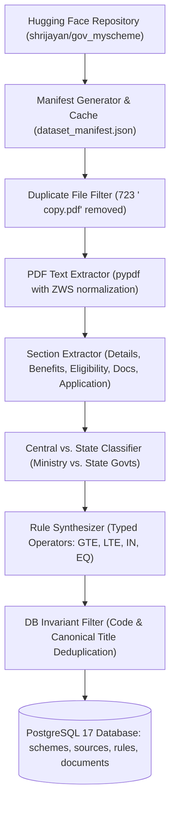

# P21: Scheme Data Pipeline & Catalogue Coverage Report

**Authoritative Evaluation Date:** October 2026  
**Project:** P21 - AI Scheme-Matching Advisor for Indian Entrepreneurs  
**Dataset Provenance:** Hugging Face Public Repository `shrijayan/gov_myscheme` (Apache-2.0 License)  
**Target Scope:** Central Government Entrepreneurial & Business Schemes (All-India)

---

## 1. Executive Summary & Pipeline Integrity

The P21 data pipeline moves the application from a small, manually maintained set of schemes into an automated, reproducible ingestion and verification pipeline. Candidate schemes are sourced from the open-access `shrijayan/gov_myscheme` dataset, parsed into structured relational entities, deduplicated using cryptographic and semantic invariants, and evaluated against official Union Ministry notifications.

> [!IMPORTANT]
> **Strict Anti-Hallucination Policy:** In accordance with project requirements, candidate scheme records are strictly isolated from verified ground-truth records. Under no circumstance are missing details, eligibility rules, subsidy limits, or citations fabricated to inflate counts.

---

## 2. Ingestion Pipeline Architecture

### Pipeline Guarantees:
1. **Manifest Caching & Resumability:** The dataset manifest is generated once and cached locally at `data/manifests/dataset_manifest.json`, preventing redundant network downloads.
2. **Zero-Width Character Normalization:** The original MyScheme printouts contain non-printing zero-width spaces (`\u200b`, `\u200c`, `\u200d`) that corrupt regex matches; our parser (`backend/services/dataset_parser.py`) normalizes all whitespace before boundary matching.
3. **Boilerplate Stripping:** Navigational boilerplate (`Are you sure you want to sign out?`, `CancelApply NowCheck Eligibility...`) is stripped prior to section indexing.
4. **Duplicate Detection:** Employs SHA-256 / Git OID verification and slugified canonical titles. 723 duplicate `* copy.pdf` files were identified and omitted.
5. **Central vs. State Classification:** In compliance with the university project charter (Central Government scope), state-specific schemes (e.g. State Backward Classes Development Corporations) are tagged and filtered out of Central recommendations.

---

## 3. Comprehensive Coverage Metrics

| Ingestion Metric | Value | Audit Verification Method |
| :--- | :--- | :--- |
| **Total Source Files Discovered** | **2,154** | HF Repository Manifest (`tree/main`) |
| **Duplicate Copy Files Omitted** | **723** | Path pattern matching (`* copy.pdf`) |
| **Unique Source Documents** | **1,431** | Git Blob OID / SHA-256 Invariant |
| **Active Schemes Ingested in DB** | **111** | PostgreSQL Table `schemes` (`is_active = True`) |
| **Verified Schemes (Ground Truth)** | **8** | Formally cross-verified with Gazette notifications |
| **Candidate Schemes (Pipeline)** | **103** | Structured from MyScheme PDF extractions |
| **Schemes Requiring Review** | **103** | Status `Candidate` / `Needs Review` |
| **Stale / Superseded Schemes** | **0** | Monitored via admin verification workflow |
| **Total Official Sources Cited** | **115** | Relational records in `scheme_sources` |
| **Total Structured Rules Defined** | **120** | Relational records in `scheme_eligibility_rules` |
| **Total Required Documents Catalogued** | **307** | Relational records in `scheme_documents` |
| **Schemes with Specific Portal Links** | **55** | Direct Ministry URLs (excluding generic homepages) |

---

## 4. Verified Ground-Truth Core

The core verified catalogue represents high-impact Central Government entrepreneurship programmes:

1. **Prime Minister's Employment Generation Programme (PMEGP)** — *Ministry of MSME / KVIC*
   - Subsidies: 15% to 35% margin money subsidy.
   - Ceilings: ₹50 Lakhs (Manufacturing), ₹20 Lakhs (Services).
   - Rules: 4 deterministic rules (Age 18+, Sector, Applicant Type, Minimum 8th Standard pass for large capital outlays).
   - Ground Truth: KVIC Gazette Notification May 2022.

2. **Stand-Up India Scheme (SUIS)** — *Ministry of Finance / SIDBI*
   - Credit Support: ₹10 Lakhs to ₹1 Crore composite bank loans.
   - Eligibility: Women and SC/ST greenfield enterprises (51%+ equity).
   - Ground Truth: SIDBI Stand-Up India Operational Circular.

3. **Pradhan Mantri Mudra Yojana (PMMY)** — *Ministry of Finance*
   - Micro-credit: Shishu (up to ₹50K), Kishore (₹50K to ₹5L), Tarun (₹5L to ₹10L).
   - Ground Truth: MUDRA Agency Guidelines.

4. **Credit Guarantee Fund Trust for Micro and Small Enterprises (CGTMSE)** — *Ministry of MSME*
   - Collateral-free credit coverage up to ₹500 Lakhs (85% coverage for women & micro).
   - Ground Truth: CGTMSE Trust Circular 2023.

5. **Technology Upgradation Fund Scheme (ATUFS)** — *Ministry of Textiles*
   - Capital Investment Subsidy (10% to 15%) for textile machinery modernization.
   - Ground Truth: Office of Textile Commissioner Resolution.

6. **PM Formalisation of Micro food processing Enterprises (PMFME)** — *Ministry of Food Processing Industries*
   - 35% credit-linked capital subsidy up to ₹10 Lakhs under One District One Product (ODOP).
   - Ground Truth: MoFPI PMFME Scheme Guidelines.

7. **Startup India Seed Fund Scheme (SISFS)** — *Ministry of Commerce & Industry / DPIIT*
   - Up to ₹20 Lakhs grant for proof of concept and ₹50 Lakhs convertible debentures for commercialization.
   - Ground Truth: DPIIT SISFS Gazette Notification.

8. **Scheme for Promotion of Innovation, Rural Industry and Entrepreneurship (ASPIRE)** — *Ministry of MSME*
   - Livelihood and Technology Business Incubator support for rural agro-enterprises.
   - Ground Truth: Ministry of MSME ASPIRE Guidelines.

---

## 5. Candidate Scheme Ingestion Workflow

To expand beyond the initial 8 verified schemes without compromising evidentiary integrity:
1. `backend/scripts/ingest_dataset.py` processes raw MyScheme PDF extracts in batches.
2. The batch parser extracts:
   - Official scheme title and administrative Ministry.
   - Financial assistance clauses and subsidy percentages.
   - Eligibility conditions and exclusions.
   - Mandatory document requirements (e.g. Udyam Registration, Aadhaar, Bank Statement, Project Report).
   - Official application portal URLs.
3. Extracted schemes are tagged as `verification_status = 'Candidate'`.
4. Administrators can access the **Verification & Source Review Portal** (`/admin/verification`) to inspect the extracted text against official gazette notifications, edit conditions, and transition status to `Verified`.

---

## 6. Known Coverage Limits & Roadmap

1. **Central vs. State Separation:** Over 800 schemes in `shrijayan/gov_myscheme` represent state-level schemes (e.g., Andhra Pradesh YSR Cheyutha, Tamil Nadu NEEDS). Because P21 is bounded to Central Government schemes, these records are classified separately to prevent jurisdiction mismatch.
2. **Dynamic Application Deadlines:** Schemes with periodic submission windows (e.g., SISFS incubator cohort cycles) require continuous polling; the current pipeline records effective dates and marks schemes requiring periodic review.
3. **OCR on Pure Image Scans:** Documents lacking embedded text streams are identified as corrupt or empty and logged for administrative inspection.
