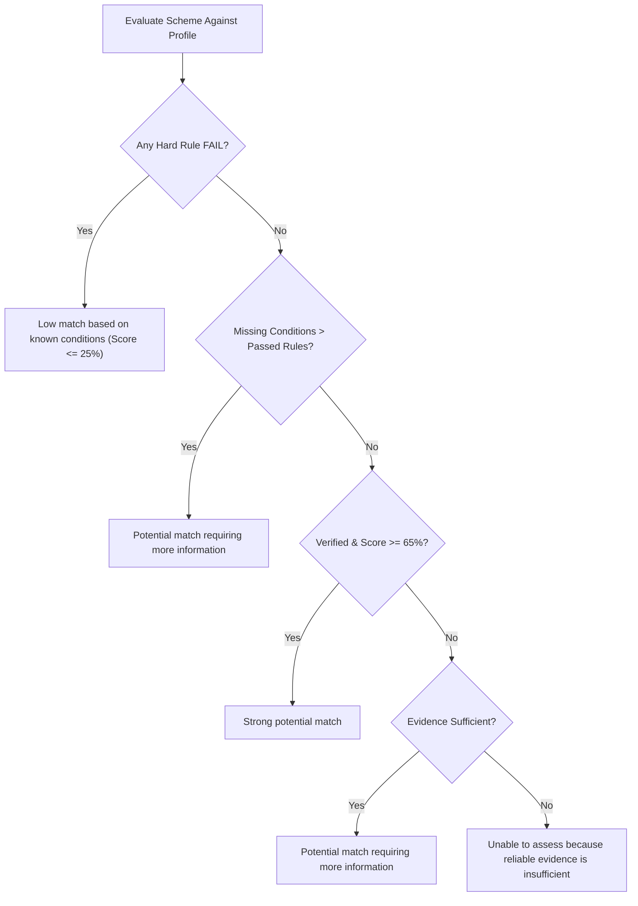

# P21: Recommendation Methodology & Eligibility Engine Specification

**Authoritative Specification**  
**Project:** P21 - AI Scheme-Matching Advisor for Indian Entrepreneurs  
**Core Module:** Deterministic Multi-Factor Recommendation & Eligibility Gap Engine  
**Implementation Files:** `backend/services/recommendation_service.py`, `backend/services/eligibility_service.py`, `backend/api/assessment_routes.py`

---

## 1. Engine Purpose & Design Principles

The P21 recommendation engine replaces simplistic keyword filtering with an explainable, multi-factor scoring and gap analysis methodology. It serves Indian entrepreneurs by answering three vital questions:

1. **"Am I eligible for this Central Government scheme?"** (Deterministic rule evaluation)
2. **"Why was I matched or disqualified?"** (Transparent factor breakdown)
3. **"What specific steps must I take next?"** (Actionable roadmaps & gap resolution)

---

## 2. Multi-Factor Transparent Scoring Formula

Each active scheme in the database is evaluated against the entrepreneur's profile across four weighted dimensions:

$$\text{FinalScore} = \left( w_e \times 0.50 \right) + \left( w_p \times 0.25 \right) + \left( w_v \times 0.15 \right) + \left( w_{ev} \times 0.10 \right)$$

### Factor Breakdown:

| Factor | Weight | Formula / Evaluation Basis |
| :--- | :--- | :--- |
| **Eligibility Factor ($w_e$)** | **50%** | $\frac{\text{Passed Rules} + (\text{Unknown Rules} \times 0.5)}{\text{Total Rules}}$ |
| **Profile Affinity ($w_p$)** | **25%** | Sector match ($+0.4$), stage match ($+0.3$), applicant type ($+0.3$) |
| **Verification Credibility ($w_v$)** | **15%** | `Verified` ($1.0$), `Needs Review` ($0.7$), `Candidate` ($0.5$), `Stale` ($0.2$) |
| **Evidence Completeness ($w_{ev}$)** | **10%** | Document count and cited sources score ($\min(1.0, \frac{\text{Sources} + \text{Docs}}{6})$) |

---

## 3. Hard Disqualification & Failure Handling

A scheme may have multiple flexible guidelines and strict mandatory exclusions. P21 models this via the `is_hard_requirement` flag on rules.

> [!CAUTION]
> **Hard Requirement Failure Rule:** If **any** hard requirement evaluates to `FAIL` (e.g. age under 18, sector outside manufacturing/service, or project outlay exceeding statutory cap), the following rules apply:
> 1. Overall assessment result is strictly set to `FAIL`.
> 2. The final match score is **capped at a maximum of 25.0%**, regardless of high scores on other factors.
> 3. The match category is assigned to **"Low match based on known conditions"**.

This prevents entrepreneurs from mistakenly applying to schemes for which they have a statutory disqualification.

---

## 4. Explainable Match Categorization

Recommendations are classified into four mutually exclusive, human-readable categories:

1. **`Strong potential match`**: Hard requirements satisfied, high profile affinity, verified official status, score $\ge 65\%$.
2. **`Potential match requiring more information`**: Core parameters align, but specific criteria (e.g. turnover limit, educational certificate) are unknown due to unpopulated profile fields.
3. **`Low match based on known conditions`**: At least one hard requirement or two flexible requirements failed.
4. **`Unable to assess because reliable evidence is insufficient`**: Candidate record lacking structured rules or verified evidence.

---

## 5. Typed Condition Evaluation & Operators

Implemented in `backend/services/eligibility_service.py`, evaluating typed conditions against profile parameters:

- **`GTE` / `LTE`**: Numeric comparisons (e.g. `business_age_months >= 24`, `annual_turnover_inr <= 50000000`).
- **`EQ` / `NEQ`**: Exact string or boolean match.
- **`IN`**: Array containment (e.g. `applicant_type IN ['individual', 'startup', 'msme']`).
- **`CONTAINS`**: Substring or array element membership (e.g. `sector CONTAINS 'textiles'`).

### Evaluation Outcomes:
- **`PASS`**: User parameter explicitly satisfies condition.
- **`FAIL`**: User parameter explicitly violates condition.
- **`UNKNOWN`**: User parameter is not yet provided in their profile (`None` / empty).
- **`NOT_APPLICABLE`**: Rule is conditional on another factor that is inactive.

---

## 6. Actionable Next Steps Generation Heuristics

For each recommended scheme, the engine generates an ordered roadmap of concrete steps:

1. **Profile Data Gaps:** If `missing_count > 0`, the engine generates an `UPDATE_PROFILE` step with direct links to the relevant profile attribute.
2. **Document Readiness:** If mandatory documents exist for the scheme, the engine generates a `DOCUMENT_PREPARATION` step linking to the checklist tracker with authority guidelines.
3. **Official Portal Submission:** If all conditions pass, the engine provides a `PORTAL_APPLICATION` step pointing to the official Union Ministry submission portal.

---

## 7. Eligibility Gap Analysis Algorithm

Implemented in `backend/api/assessment_routes.py` (`GET /api/assessments/gap-analysis/{scheme_id}`):

1. **Profile Parameter Isolation:** Compares rules against user attributes and isolates missing fields.
2. **Why It Matters Contextualization:** Synthesizes human-readable rationales explaining how completing the parameter affects the match.
3. **Disqualification Explanations:** Formulates explicit comparative statements (e.g. *"Your investment outlay is ₹80,00,000, which exceeds the maximum ceiling of ₹50,00,000 allowed under PMEGP."*).
4. **Document Inventory Summary:** Tallies mandatory vs. optional certificates and loads issuing authority instructions.
