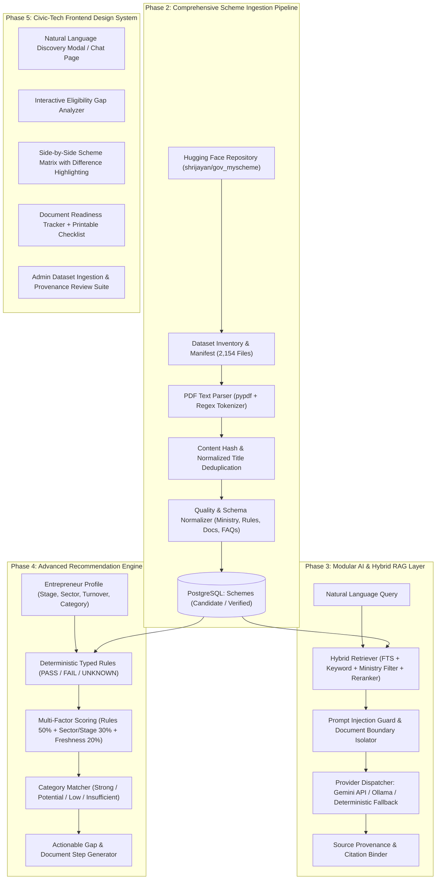

# P21 System Upgrade Architecture & Implementation Plan

**Author**: Senior Software Architect & Engineering Team  
**Status**: Approved for Implementation  
**Target Completion**: Phase-by-phase with verification gates  

---

## 1. Upgrade Architectural Blueprint

---

## 2. Phase Breakdown & Implementation Priority

### Phase 2: Scheme Data Pipeline & Hugging Face Dataset Ingestion
- **Objective**: Expand scheme repository from 12 schemes to hundreds of deduplicated, structured Central Government schemes.
- **Components**:
  1. `backend/services/dataset_parser.py`: Robust PDF & text extraction parsing title, ministry, brief, benefits, eligibility, exclusions, application steps, required documents, FAQs, and official URLs.
  2. `backend/services/ingestion_service.py`: Automated manifest fetcher, resume cache, content-hash deduplication, structured database ingestion with provenance tracking (`source_type="myscheme_dataset"`).
  3. `backend/scripts/ingest_dataset.py`: CLI and background task worker with progress bar, batch commits, and error logging.
  4. Database migration: Ensure indexing for full-text search (`tsvector` or optimized text trigram indexes).

### Phase 3: Real Modular AI Layer & RAG Search
- **Objective**: Build a real, useful AI service that answers natural language questions grounded in scheme evidence.
- **Components**:
  1. `backend/services/ai_service.py`: Provider-agnostic abstraction supporting:
     - `gemini`: Google Gemini API via official HTTP interface (`gemini-1.5-flash` or `gemini-2.0-flash` with streaming / structured output).
     - `ollama`: Local LLM (`llama3.2`).
     - `deterministic`: High-precision rules fallback when models are offline.
  2. `backend/services/rag_service.py`: Hybrid retrieval querying scheme descriptions, rules, and sources. Builds citation references directly to database records.
  3. `backend/api/ai_routes.py`: Endpoints for `/api/ai/ask` (natural language query), `/api/ai/explain` (assessment reasoning), and `/api/ai/health` (provider status check).

### Phase 4: Upgraded Recommendation & Gap Analysis Engine
- **Objective**: Replace basic counts with explainable multi-factor scoring and personalized next steps.
- **Components**:
  1. `backend/services/recommendation_service.py`:
     - Scoring formula: $S = w_r S_{rules} + w_p S_{profile} + w_v S_{verification} + w_e S_{evidence}$.
     - Match categorizer: `Strong potential match`, `Potential match requiring more information`, `Low match based on known conditions`, `Unable to assess because reliable evidence is insufficient`.
  2. Actionable next steps generator: Derives exact tasks (e.g., "Obtain Udhyam Certificate", "Complete Project Report with 7-year projections").
  3. `backend/api/assessment_routes.py`: Enhanced recommendation and gap endpoints.

### Phase 5: Civic-Tech Frontend Elevation & Deeper Features
- **Objective**: Professional enterprise/civic design system with exceptional responsiveness and zero dead ends.
- **Components**:
  1. **Natural Language Discovery View (`AIDiscoveryPage.tsx` / Chat Assistant)**: Instant conversational queries grounded in verified schemes.
  2. **Eligibility Gap Analysis View (`EligibilityGapPage.tsx`)**: Clear breakdown of unmet criteria with inline profile update triggers.
  3. **Enhanced Comparison View (`SchemeComparisonPage.tsx`)**: Highlighting critical differences in subsidy percentages, caps, and required documents.
  4. **Document Readiness Suite (`DocumentChecklistPage.tsx`)**: Downloadable / printable checklist with authority guidance and verification tips.
  5. **Admin Ingestion & Governance Dashboard (`AdminIngestionPage.tsx`)**: Live progress indicators, extraction review, duplicate inspection, and batch verification actions.
  6. **Scheme Freshness Alerts**: Warning badges when scheme rules have been updated after an assessment date.

### Phase 6: Verification, Automated Testing & Documentation
- **Components**:
  1. Pytest suite extension: Ingestion tests, RAG retrieval tests, multi-factor recommendation tests, AI fallback tests, admin ingestion authorization tests.
  2. Frontend build & accessibility validation (`npm run build`, linting).
  3. University documentation deliverables:
     - `docs/data-coverage-report.md`
     - `docs/ai-architecture.md`
     - `docs/recommendation-methodology.md`
     - `docs/upgrade-test-report.md`
     - `README.md` & `BUILD_STATUS.md` updates.
